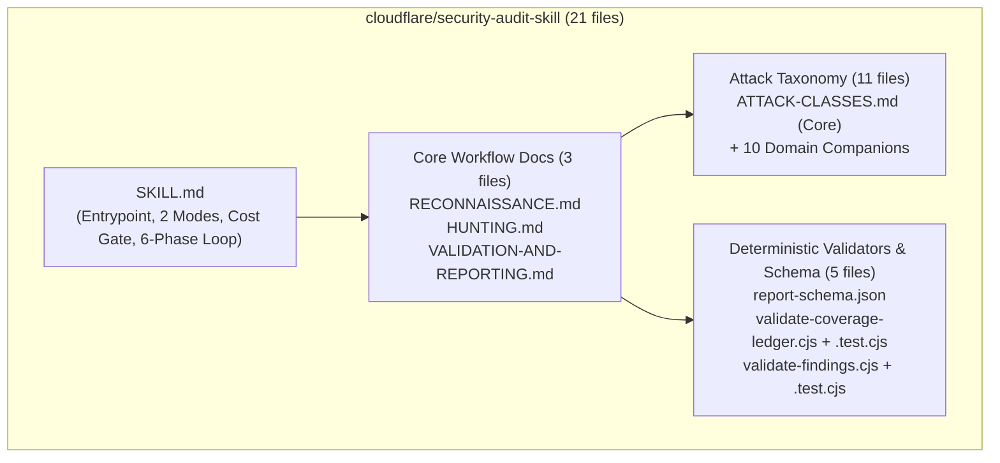

# Báo Cáo Đánh Giá Toàn Diện: `cloudflare/security-audit-skill` vs. Local `AI-skills` (`LocalSec v2.4.0`)

> [!IMPORTANT]
> **Phạm vi khảo sát:** Đã đọc toàn bộ **100% (21/21 files, ~5,180 dòng)** của repository [`cloudflare/security-audit-skill`](file:///Volumes/External_Disk/timo/projects/appsec/localsec-antigravity-skills/docs/sessions/3a2febb8-99cf-4ce0-ab14-a1bc51071828/cloudflare-security-audit-skill/README.md) và đối chiếu trực tiếp với kiến trúc của bộ [`AI-skills` (`localsec-antigravity-skills` v2.4.0-refute-first)](file:///Volumes/External_Disk/timo/projects/appsec/localsec-antigravity-skills/README.md) đang sử dụng tại local (gồm 28 Antigravity Skills, 2 Normative Contracts, 25 JSON Schemas và ~17,887 dòng Python Epistemic Engine).

---

## 1. Giải Phẫu Toàn Bộ Repo `cloudflare/security-audit-skill`

Repository của Cloudflare là một **single-skill package** (`skills/security-audit/`) đóng vai trò là hạt nhân khởi tạo (seed) cho hệ thống săn tìm lỗ hổng tự động của Cloudflare. Toàn bộ repo gồm 4 nhóm thành phần chính:

### 1.1. Điều phối trung tâm & Chế độ vận hành ([`SKILL.md`](file:///Volumes/External_Disk/timo/projects/appsec/localsec-antigravity-skills/docs/sessions/3a2febb8-99cf-4ce0-ab14-a1bc51071828/cloudflare-security-audit-skill/skills/security-audit/SKILL.md#L1-L193))
- **2 Chế độ vận hành (Operating Modes):**
  1. **Guidance Mode (Mặc định):** Trả lời câu hỏi bảo mật, giải thích cơ chế, hoặc review nhanh một đoạn code/diff mà không sinh thư mục run hay chạy pipeline đa pha.
  2. **Full Audit Mode:** Khi được yêu cầu audit repo/subsystem, chạy pipeline **6 Phases** và ghi kết quả ra `~/security-audit-skill/<repo-name>/run-<N>`.
- **3 Run Profiles & Cost Budget Gate ([`SKILL.md`](file:///Volumes/External_Disk/timo/projects/appsec/localsec-antigravity-skills/docs/sessions/3a2febb8-99cf-4ce0-ab14-a1bc51071828/cloudflare-security-audit-skill/skills/security-audit/SKILL.md#L76-L97)):**
  - Chia thành `quick` (~6–12 agent calls, 1 wave), `standard` (~12–24 agent calls, tối đa 3 waves + final-clean critic), và `deep` (~24–40+ agent calls, tối đa 5 waves + final-clean critic).
  - **Cơ chế dự trữ ngân sách (Budget Reservation):** Trước khi phóng thêm hunter ở Phase 2, orchestrator bắt buộc phải giữ lại ngân sách cho ít nhất: `1 coverage critic` + `1 final-clean critic` (nếu `standard`/`deep`) + `1 Phase 3 verifier` cho mỗi candidate + `1 Phase 5 record verifier` cho mỗi finding dự kiến.
- **5 Đạo luật Bất khả xâm phạm (Non-Negotiable Rules - [`SKILL.md`](file:///Volumes/External_Disk/timo/projects/appsec/localsec-antigravity-skills/docs/sessions/3a2febb8-99cf-4ce0-ab14-a1bc51071828/cloudflare-security-audit-skill/skills/security-audit/SKILL.md#L33-L40)):**
  1. Không bao giờ báo cáo một finding là `confirmed` nếu chưa tự đọc đầy đủ đường đi trên source code (hoặc quan sát runtime local) và chưa qua một agent độc lập kiểm chứng.
  2. Luôn giữ thái độ trung lập với mục tiêu (target-neutral): không mặc định phần mềm tốt hay xấu; phải phân biệt rõ *intended trade-offs*, *hardening ideas*, *incomplete validation* và *actual vulnerabilities*.
  3. Không bao giờ gửi dữ liệu của repo mục tiêu ra dịch vụ bên ngoài, hạ tầng của tổ chức mục tiêu, hoặc mạng ngoài.
  4. Không được kết thúc full audit khi chưa hoàn tất: `reconnaissance` -> `coverage-ledger.json` -> `>=1 hunting wave` -> `>=1 coverage-critic pass` -> `independent validation` -> `validator pass` -> `independent record verification`.
  5. Mọi đường dẫn trong artifact phải là repo-relative (`path/to/file.ext:123`).

### 1.2. Quy trình 6 Phases chi tiết
1. **Phase 1 — Reconnaissance ([`RECONNAISSANCE.md`](file:///Volumes/External_Disk/timo/projects/appsec/localsec-antigravity-skills/docs/sessions/3a2febb8-99cf-4ce0-ab14-a1bc51071828/cloudflare-security-audit-skill/skills/security-audit/RECONNAISSANCE.md#L1-L157)):**
   - Phóng 4 `research` agents chạy song song: **1a** (Product, stack, local buildability), **1b** (Principals, authority, controls), **1c** (Entry surfaces, copies, sinks), **1d** (Local execution & deployment visibility).
   - Tổng hợp thành `architecture.md` (giới hạn `<= 1,000 từ`) và khởi tạo `coverage-ledger.json`.
   - Mỗi đơn vị độ phủ (`coverage unit`) mang một mã định danh tất định theo chuẩn RFC 3986 percent-encoding: `surface::boundary::subsystem::attack_class[::lifecycle]`.
   - Hỗ trợ **Incremental Multi-Run Audit**: Nếu có `run-<N-1>`, tự động đối chiếu lịch sử để gán `prior_status` (`new`, `prior_confirmed_same_source`, `prior_confirmed_changed_source`, `prior_blocked_or_deferred`, v.v.).
2. **Phase 2 — Coverage-Led Hunting Waves ([`HUNTING.md`](file:///Volumes/External_Disk/timo/projects/appsec/localsec-antigravity-skills/docs/sessions/3a2febb8-99cf-4ce0-ab14-a1bc51071828/cloudflare-security-audit-skill/skills/security-audit/HUNTING.md#L1-L252)):**
   - Mỗi hunter (`general` subagent) được giao một tập `coverage_id` từ sổ cái.
   - **Rule nạp tri thức chống suy giảm (Anti-Dilution Prompt Injection):** Orchestrator không được tự tóm tắt các tài liệu tấn công mà phải **copy nguyên văn (verbatim)** các block từ [`ATTACK-CLASSES.md`](file:///Volumes/External_Disk/timo/projects/appsec/localsec-antigravity-skills/docs/sessions/3a2febb8-99cf-4ce0-ab14-a1bc51071828/cloudflare-security-audit-skill/skills/security-audit/ATTACK-CLASSES.md#L1-L131) và 10 file Domain Companions (`Core discipline`, `Attack classes`, `Universal moves`, `Validation rules`) vào prompt của hunter, kèm danh sách các block bị loại trừ và lý do.
   - **Coverage Critic Loop ([`HUNTING.md`](file:///Volumes/External_Disk/timo/projects/appsec/localsec-antigravity-skills/docs/sessions/3a2febb8-99cf-4ce0-ab14-a1bc51071828/cloudflare-security-audit-skill/skills/security-audit/HUNTING.md#L170-L246)):** Sau mỗi wave, một `research` agent mới đóng vai **Coverage Critic** kiểm tra xem có entry point nào bị sót, có nhánh song song nào chưa đọc (ví dụ: đã đọc HTTP handler nhưng quên WebSocket/CLI/gRPC), hoặc có đơn vị nào bị đóng (`covered`) quá sớm không. Nếu Critic yêu cầu mở lại (`reassign_ids`), lượt thử cũ được lưu vào mảng bất biến `attempts[]` và bắt buộc phải giao cho một `agent_id` mới hoàn toàn.
   - **Race-Safe Artifact Promotion ([`HUNTING.md`](file:///Volumes/External_Disk/timo/projects/appsec/localsec-antigravity-skills/docs/sessions/3a2febb8-99cf-4ce0-ab14-a1bc51071828/cloudflare-security-audit-skill/skills/security-audit/HUNTING.md#L118-L147)):** Quy trình 11 bước dùng `O_NOFOLLOW`, `fstat` trên file descriptor, kiểm tra regular file, cứng hóa giới hạn 1 MiB/file và 10 MiB/run trước khi copy log/reproducer từ sandbox sang `artifacts/<coverage_id>/`.
3. **Phase 3 — Candidate Validation ([`VALIDATION-AND-REPORTING.md`](file:///Volumes/External_Disk/timo/projects/appsec/localsec-antigravity-skills/docs/sessions/3a2febb8-99cf-4ce0-ab14-a1bc51071828/cloudflare-security-audit-skill/skills/security-audit/VALIDATION-AND-REPORTING.md#L1-L55)):**
   - Gộp các candidate trùng lặp qua `fingerprint` (`sink + root cause + path`).
   - Mỗi candidate (`confirmed` hoặc `needs_validation`) đượcส่ง cho một `general` verifier độc lập với prompt định hướng bác bỏ (*"You did not write this candidate. Try to refute it..."*).
4. **Phase 4 — Structured Output ([`VALIDATION-AND-REPORTING.md`](file:///Volumes/External_Disk/timo/projects/appsec/localsec-antigravity-skills/docs/sessions/3a2febb8-99cf-4ce0-ab14-a1bc51071828/cloudflare-security-audit-skill/skills/security-audit/VALIDATION-AND-REPORTING.md#L56-L91)):**
   - Ghi `findings.json` và chạy 2 bộ validator Node.js: [`validate-findings.cjs`](file:///Volumes/External_Disk/timo/projects/appsec/localsec-antigravity-skills/docs/sessions/3a2febb8-99cf-4ce0-ab14-a1bc51071828/cloudflare-security-audit-skill/skills/security-audit/validate-findings.cjs#L1-L774) và [`validate-coverage-ledger.cjs`](file:///Volumes/External_Disk/timo/projects/appsec/localsec-antigravity-skills/docs/sessions/3a2febb8-99cf-4ce0-ab14-a1bc51071828/cloudflare-security-audit-skill/skills/security-audit/validate-coverage-ledger.cjs#L1-L873).
5. **Phase 5 — Independent Record Verification ([`VALIDATION-AND-REPORTING.md`](file:///Volumes/External_Disk/timo/projects/appsec/localsec-antigravity-skills/docs/sessions/3a2febb8-99cf-4ce0-ab14-a1bc51071828/cloudflare-security-audit-skill/skills/security-audit/VALIDATION-AND-REPORTING.md#L93-L148)):**
   - Một lớp kiểm định thứ hai bằng `research` agent đọc trực tiếp bản ghi trong `findings.json` đối chiếu lại với mã nguồn thật và `architecture.md`. Nếu bản ghi bị sửa đổi trọng yếu hoặc nâng cấp từ `needs_validation` lên `confirmed`, nó phải đi qua thêm **một verifier độc lập mới nữa** trước khi được chấp nhận.
6. **Phase 6 — Target-Neutral Reporting ([`VALIDATION-AND-REPORTING.md`](file:///Volumes/External_Disk/timo/projects/appsec/localsec-antigravity-skills/docs/sessions/3a2febb8-99cf-4ce0-ab14-a1bc51071828/cloudflare-security-audit-skill/skills/security-audit/VALIDATION-AND-REPORTING.md#L150-L187)):**
   - Xuất `REPORT.md`, `FINDINGS-DETAIL.md`, và `NEEDS-VALIDATION.md`.

### 1.3. Hệ thống 10 Domain Companions & Validators của Cloudflare
- **Core Taxonomy ([`ATTACK-CLASSES.md`](file:///Volumes/External_Disk/timo/projects/appsec/localsec-antigravity-skills/docs/sessions/3a2febb8-99cf-4ce0-ab14-a1bc51071828/cloudflare-security-audit-skill/skills/security-audit/ATTACK-CLASSES.md#L1-L131)) + 10 Domain Companions:**
  1. [`AI-AND-LLM.md`](file:///Volumes/External_Disk/timo/projects/appsec/localsec-antigravity-skills/docs/sessions/3a2febb8-99cf-4ce0-ab14-a1bc51071828/cloudflare-security-audit-skill/skills/security-audit/AI-AND-LLM.md#L1-L84): Indirect prompt injection, RAG/vector memory poisoning, tool-call confused deputy, MCP server/tool identity spoofing, action-confirmation binding.
  2. [`WEB-PROTOCOL-AND-AUTH.md`](file:///Volumes/External_Disk/timo/projects/appsec/localsec-antigravity-skills/docs/sessions/3a2febb8-99cf-4ce0-ab14-a1bc51071828/cloudflare-security-audit-skill/skills/security-audit/WEB-PROTOCOL-AND-AUTH.md#L1-L106): HTTP request smuggling/desync, web cache poisoning/deception, SAML XML wrapping, WebAuthn/passkey counter & RP ID binding, OAuth/OIDC PKCE/state/redirect_uri, mTLS header spoofing.
  3. [`CLIENT-SIDE.md`](file:///Volumes/External_Disk/timo/projects/appsec/localsec-antigravity-skills/docs/sessions/3a2febb8-99cf-4ce0-ab14-a1bc51071828/cloudflare-security-audit-skill/skills/security-audit/CLIENT-SIDE.md#L1-L84): DOM XSS, DOM clobbering, Prototype pollution + gadgets, `postMessage` origin/source checks, CSWSH, Service Worker cache/scope confusion, XS-Leaks.
  4. [`MEMORY-SAFETY-AND-BINARY.md`](file:///Volumes/External_Disk/timo/projects/appsec/localsec-antigravity-skills/docs/sessions/3a2febb8-99cf-4ce0-ab14-a1bc51071828/cloudflare-security-audit-skill/skills/security-audit/MEMORY-SAFETY-AND-BINARY.md#L1-L102): C/C++/Rust `unsafe`, FFI/ABI invariants, integer overflow -> buffer size, UAF/double-free, kernel user-copy double-fetch, uninitialized memory disclosure.
  5. [`CLOUD-AND-DEPLOYMENT.md`](file:///Volumes/External_Disk/timo/projects/appsec/localsec-antigravity-skills/docs/sessions/3a2febb8-99cf-4ce0-ab14-a1bc51071828/cloudflare-security-audit-skill/skills/security-audit/CLOUD-AND-DEPLOYMENT.md#L1-L87): IAM/RBAC wildcard escalation, K8s admission webhook bypass, cloud metadata SSRF (IMDS), Helm/Kustomize prod overlay drift.
  6. [`SUPPLY-CHAIN-AND-RELEASE.md`](file:///Volumes/External_Disk/timo/projects/appsec/localsec-antigravity-skills/docs/sessions/3a2febb8-99cf-4ce0-ab14-a1bc51071828/cloudflare-security-audit-skill/skills/security-audit/SUPPLY-CHAIN-AND-RELEASE.md#L1-L74): Dependency confusion, GitHub Actions `pull_request_target` / `workflow_run` pwn requests, build cache poisoning, artifact digest substitution, auto-updater downgrade.
  7. [`PROTOCOLS-RPC-AND-MESSAGING.md`](file:///Volumes/External_Disk/timo/projects/appsec/localsec-antigravity-skills/docs/sessions/3a2febb8-99cf-4ce0-ab14-a1bc51071828/cloudflare-security-audit-skill/skills/security-audit/PROTOCOLS-RPC-AND-MESSAGING.md#L1-L82): gRPC/Protobuf/GraphQL batching & per-message streaming authz, queue poison-pill / DLQ disclosure, outbox commit ordering.
  8. [`RESOURCE-EXHAUSTION-AND-AVAILABILITY.md`](file:///Volumes/External_Disk/timo/projects/appsec/localsec-antigravity-skills/docs/sessions/3a2febb8-99cf-4ce0-ab14-a1bc51071828/cloudflare-security-audit-skill/skills/security-audit/RESOURCE-EXHAUSTION-AND-AVAILABILITY.md#L1-L79): Superlinear regex/parser complexity, zip/XML decompression bombs, GraphQL/SQL amplification, FD/connection pool leak trên nhánh lỗi, pre-auth asymmetric work.
  9. [`DATA-ISOLATION-AND-LIFECYCLE.md`](file:///Volumes/External_Disk/timo/projects/appsec/localsec-antigravity-skills/docs/sessions/3a2febb8-99cf-4ce0-ab14-a1bc51071828/cloudflare-security-audit-skill/skills/security-audit/DATA-ISOLATION-AND-LIFECYCLE.md#L1-L85): Multi-tenant composite key delimiter collision, search/analytics index ACL drift, soft-delete/purge/restore reviving revoked access.
  10. [`DESKTOP-MOBILE-AND-LOCAL-IPC.md`](file:///Volumes/External_Disk/timo/projects/appsec/localsec-antigravity-skills/docs/sessions/3a2febb8-99cf-4ce0-ab14-a1bc51071828/cloudflare-security-audit-skill/skills/security-audit/DESKTOP-MOBILE-AND-LOCAL-IPC.md#L1-L90): Custom URI schemes / deep links, Electron/WebView JS bridge, XPC/Binder/D-Bus/Unix socket peer PID/UID verification, privileged helper TOCTOU.
- **Validators cực kỳ chặt chẽ ([`validate-coverage-ledger.cjs`](file:///Volumes/External_Disk/timo/projects/appsec/localsec-antigravity-skills/docs/sessions/3a2febb8-99cf-4ce0-ab14-a1bc51071828/cloudflare-security-audit-skill/skills/security-audit/validate-coverage-ledger.cjs#L1-L873) & [`validate-findings.cjs`](file:///Volumes/External_Disk/timo/projects/appsec/localsec-antigravity-skills/docs/sessions/3a2febb8-99cf-4ce0-ab14-a1bc51071828/cloudflare-security-audit-skill/skills/security-audit/validate-findings.cjs#L1-L774)):**
  - Zero-dependency CommonJS, có bộ unit test riêng ([`validate-coverage-ledger.test.cjs`](file:///Volumes/External_Disk/timo/projects/appsec/localsec-antigravity-skills/docs/sessions/3a2febb8-99cf-4ce0-ab14-a1bc51071828/cloudflare-security-audit-skill/skills/security-audit/validate-coverage-ledger.test.cjs#L1-L741), [`validate-findings.test.cjs`](file:///Volumes/External_Disk/timo/projects/appsec/localsec-antigravity-skills/docs/sessions/3a2febb8-99cf-4ce0-ab14-a1bc51071828/cloudflare-security-audit-skill/skills/security-audit/validate-findings.test.cjs#L1-L653)).
  - Mở file bằng `O_NOFOLLOW | O_NONBLOCK`, chặn symlink/FIFO/socket; pre-parse JSON stream giới hạn 5 MiB, độ sâu lồng nhau 64, tối đa 500,000 JSON values; chặn Windows reserved names (`CON`, `NUL`, `COM1`, `CLOCK$`); chặn Unicode lone surrogates, terminal escape (`\u001b`) và BiDi control characters.
  - Kiểm tra ngữ nghĩa: `overall_severity <= impact.score`, thứ tự `trace` bắt buộc bắt đầu bằng `entrypoint` và kết thúc bằng `sink`, mọi `coverage_ids` trong `findings.json` phải tồn tại và ở trạng thái `candidate` trong `coverage-ledger.json`.

---

## 2. Bảng Đối Chiếu Toàn Diện: `cloudflare/security-audit-skill` vs. Local `AI-skills` (`LocalSec v2.4.0`)

| Trục Đánh Giá | `cloudflare/security-audit-skill` | Local `AI-skills` (`LocalSec v2.4.0-refute-first`) | Bên Vượt Trội |
| :--- | :--- | :--- | :--- |
| **1. Kiến trúc tổng thể** | **1 Skill duy nhất** (15 file Markdown hướng dẫn + 1 JSON Schema + 2 Node.js `.cjs` validators). Phụ thuộc hoàn toàn vào khả năng tuân thủ prompt của Agent chủ. | **28 Antigravity Skills** (3 Master Orchestrators + 25 Specialist Sub-skills) + **Python Epistemic Engine (`localsec`, ~17.8k LOC)** + 25 JSON Schemas + 2 Normative Contracts. | **Local `AI-skills`** (Engine thực thi & cưỡng chế bằng code Python thay vì chỉ nhắc bằng prompt) |
| **2. Phạm vi mục tiêu (Scope)** | **Single-repository** (thiết kế cho 1 repo độc lập, có hỗ trợ chạy lặp nhiều run trên cùng repo đó). | **Multi-repository Ecosystem** (hỗ trợ 10–30+ repos microservices .NET/Go/Java, mobile, ETL, DB pipeline, đọc liên repo `<other_repo>:<rel_path>`). | **Local `AI-skills`** (Vượt trội tuyệt đối ở bài toán Enterprise/BFSI đa dịch vụ) |
| **3. Chống bịa đặt bằng chứng (Anti-Hallucination & Provenance)** | Agent tự đọc file bằng native tool và **tự gõ chuỗi `file:line`** vào JSON. Validator chỉ kiểm tra cú pháp regex của đường dẫn, không biết agent có thực sự đọc dòng đó hay bịa nội dung. Phải chờ Verifier ở Phase 3/5 đọc lại bằng cơm. | **Cryptographic Evidence Minting ([`ManualWorkspace.read_file`](file:///Volumes/External_Disk/timo/projects/appsec/localsec-antigravity-skills/localsec/workspace.py#L469-L557))**: Chỉ khi đọc qua CLI mới sinh mã băm `ev_<18-hex>` gắn với nội dung thực, git SHA, mtime. Kèm [`verify_claim_to_excerpt_semantics`](file:///Volumes/External_Disk/timo/projects/appsec/localsec-antigravity-skills/localsec/validators.py#L140-L246) tự động đối chiếu symbol trong claim với excerpt thật. | **Local `AI-skills`** (Chặn ảo giác ở tầng mật mã & ngữ nghĩa ngay lúc submit) |
| **4. Context-Blinding (Chống thiên kiến xác nhận)** | **Prompt-based**: Dặn orchestrator trong [`VALIDATION-AND-REPORTING.md`](file:///Volumes/External_Disk/timo/projects/appsec/localsec-antigravity-skills/docs/sessions/3a2febb8-99cf-4ce0-ab14-a1bc51071828/cloudflare-security-audit-skill/skills/security-audit/VALIDATION-AND-REPORTING.md#L18-L41) không tiết lộ kết luận của verifier trước cho verifier sau. | **Runtime-enforced in Python ([`orchestrator.py`](file:///Volumes/External_Disk/timo/projects/appsec/localsec-antigravity-skills/localsec/orchestrator.py#L909-L1014))**: Hàm `build_blinded_*` tự động cắt bỏ `threat_model`, `comparison_result`, `chain_verdict` trước khi xuất file JSON cho subagent, đồng thời khóa `--allowed-paths` ở tầng đọc file. | **Local `AI-skills`** (Cưỡng chế tách biệt ngữ cảnh bằng thuật toán tất định) |
| **5. Đối chiếu Nghiệp vụ vs. Code (Business Intent Verification)** | Không có pha chuyên biệt cho tài liệu nghiệp vụ rời. Chỉ đọc `README`/docs có sẵn trong repo trong Phase 1a để hiểu kiến trúc. | **Phase 2 BASV chuyên biệt ([`BUSINESS_AWARE_SECURITY_VERIFICATION.md`](file:///Volumes/External_Disk/timo/projects/appsec/localsec-antigravity-skills/contracts/business-aware-security-verification-v1/BUSINESS_AWARE_SECURITY_VERIFICATION.md#L1-L273))**: Đọc trực tiếp `.docx`, `.xlsx`, `.sql` BRD/BRS, phân cấp `source_rank 1..4`, chống tự so sánh vòng lặp (`circular self-comparison`), dựng đồ thị mâu thuẫn 5 chiều ([`build_cross_artifact_contradiction_graph`](file:///Volumes/External_Disk/timo/projects/appsec/localsec-antigravity-skills/localsec/orchestrator.py#L707-L787)). | **Local `AI-skills`** (Khả năng đọc hiểu BRD/BRS `.docx`/`.xlsx` và kiểm toán logic nghiệp vụ BFSI độc nhất) |
| **6. Phân tích Chuỗi tấn công đa bước (Multi-Hop Attack Chains)** | Lưu dưới dạng mảng tuyến tính `trace[]` (`entrypoint -> propagation -> sink`) trong mỗi finding của `findings.json`. | **Phase 3 ACA chuyên biệt ([`ATTACK_CHAIN_ANALYSIS.md`](file:///Volumes/External_Disk/timo/projects/appsec/localsec-antigravity-skills/contracts/attack-chain-analysis-v1/ATTACK_CHAIN_ANALYSIS.md#L1-L248))**: Mô hình hóa đồ thị `steps[]` + `linked_next_steps[]`, kiểm định tính bắc cầu của trạng thái (`state_before` -> `state_after`), ánh xạ `root_cause_mapper` và kiểm soát hội tụ [`check_aca_convergence`](file:///Volumes/External_Disk/timo/projects/appsec/localsec-antigravity-skills/localsec/orchestrator.py#L790-L906). | **Local `AI-skills`** (Mô hình hóa chuỗi tấn công liên repo và kiểm soát bùng nổ giả thuyết sâu sắc hơn) |
| **7. Quản trị Độ phủ (Coverage Tracking & Critic Loop)** | **Xuất sắc**: `coverage-ledger.json` định danh từng đơn vị `surface::boundary::subsystem::attack_class`, có trạng thái tường minh, lưu lịch sử `attempts[]` bất biến khi bị **Coverage Critic** mở lại, bắt buộc đổi `agent_id` mới, và hỗ trợ diff đa run (`prior_status`). | Theo dõi ở mức độ hoàn thành từng bước (`phase_status` 26 steps), số lượng file/evidence đã đọc (`coverage.json`), và ma trận 5 miền nghiệp vụ (`authn`, `authz`, `state_workflow`, `financial_integrity`, `sensitive_data`). Chưa có sổ cái độ phủ chi tiết tới từng cặp `entrypoint x attack_class`. | **`cloudflare/security-audit-skill`** (Sổ cái độ phủ chi tiết, cơ chế Coverage Critic mở lại đơn vị bị đóng sớm, và diff liên run rất đáng học hỏi) |
| **8. Độ rộng Kho tri thức Tấn công Kỹ thuật (Technical Attack Taxonomy)** | **11 tài liệu chuyên sâu** bao phủ từ Memory Safety/Kernel/FFI, AI/LLM/MCP, HTTP Desync/Cache Poisoning/WebAuthn/SAML, Client-Side DOM/XS-Leaks, Supply Chain/GitHub Actions, K8s/Cloud, gRPC/Messaging, ReDoS/DoS, đến Mobile/Desktop IPC. | Mạnh về **Business Logic, API Authz, JWT/Crypto, Microservice Trust Boundary, Financial/BFSI Invariants**, nhưng thiếu các cẩm nang chuyên biệt cho Memory Safety/Binary, Client-side DOM/Service Worker, CI/CD Supply Chain, LLM/MCP, và Desktop/Mobile IPC. | **`cloudflare/security-audit-skill`** (Phổ tri thức kỹ thuật đa nền tảng rộng và sắc bén hơn nhiều) |
| **9. Kiểm chứng Thực thi Động (Dynamic / Local Validation)** | Cho phép chạy unit test, fuzz/sanitizer harness, hoặc reproducer trong **OS-enforced local sandbox** (cấm mạng ngoài) và thu thập log qua giao thức 11 bước chống symlink race (`O_NOFOLLOW`). | Mặc định **Static-First** (cấm build/shell trong Phase 1 & 2); Phase 3 hỗ trợ [`execute_constrained_local_request`](file:///Volumes/External_Disk/timo/projects/appsec/localsec-antigravity-skills/localsec/orchestrator.py#L1016-L1060) chỉ gửi HTTP request tới `localhost`/`127.0.0.1` khi có `operator_approved = True`. | **Tùy bài toán**: Cloudflare linh hoạt hơn khi repo tự chạy được unit test/sanitizer local; `AI-skills` an toàn hơn cho môi trường Enterprise không thể dựng full stack local. |
| **10. Độ cứng vững của Validator ở tầng I/O & Parser** | [`validate-coverage-ledger.cjs`](file:///Volumes/External_Disk/timo/projects/appsec/localsec-antigravity-skills/docs/sessions/3a2febb8-99cf-4ce0-ab14-a1bc51071828/cloudflare-security-audit-skill/skills/security-audit/validate-coverage-ledger.cjs#L37-L239) chống DoS parser (5 MiB, depth 64, 500k values), mở file `O_NOFOLLOW | O_NONBLOCK`, chặn Unicode BiDi/ANSI escape injection và Windows device names. | [`validators.py`](file:///Volumes/External_Disk/timo/projects/appsec/localsec-antigravity-skills/localsec/validators.py#L1-L495) rất mạnh về kiểm tra **ngữ nghĩa nhận thức luận** (provenance, circularity, semantic excerpt match, evidence IDs), nhưng dùng `json.loads` tiêu chuẩn trên dữ liệu do chính session quản lý. | **Bổ sung cho nhau**: `AI-skills` mạnh hơn về Epistemic Semantics; Cloudflare mạnh hơn về Low-level I/O & Parser Hardening. |

---

## 3. Phân Tích Chuyên Sâu: Những Điểm Local `AI-skills` Đã Vượt Xa Cloudflare

1. **Chuẩn mực Nhận thức luận (Epistemic Rigor) được cưỡng chế bằng Code thay vì Lời dặn:**
   - Trong `cloudflare/security-audit-skill`, toàn bộ quy trình dựa vào việc LLM đọc file Markdown và *tự giác* làm theo (tự ghi `coverage-ledger.json`, tự trích dẫn `file:line`, tự không nhìn kết quả của agent trước). Nếu LLM "ăn gian" điền một dòng code có thật nhưng nội dung dòng đó không hề chứa lỗ hổng, bộ validator `.cjs` của Cloudflare **không thể phát hiện được** (vì validator `.cjs` chỉ kiểm tra JSON schema, không đọc source code hay đối chiếu excerpt).
   - Ngược lại, trong `AI-skills`, [`ManualWorkspace`](file:///Volumes/External_Disk/timo/projects/appsec/localsec-antigravity-skills/localsec/workspace.py#L225-L754) và [`manual_session.py`](file:///Volumes/External_Disk/timo/projects/appsec/localsec-antigravity-skills/localsec/manual_session.py#L1-L1351) đóng vai trò là một **Reference Monitor**:
     - Agent không thể bịa ra `ev_<18-hex>` nếu chưa thực sự gọi lệnh `read_file` trên đúng khoảng dòng đó.
     - Hàm [`verify_claim_to_excerpt_semantics`](file:///Volumes/External_Disk/timo/projects/appsec/localsec-antigravity-skills/localsec/validators.py#L140-L246) kiểm tra tất định các ký hiệu kỹ thuật trong lời khẳng định so với nội dung văn bản thực tế của excerpt.
     - Hàm [`evaluate_contextual_evidence_strength`](file:///Volumes/External_Disk/timo/projects/appsec/localsec-antigravity-skills/localsec/orchestrator.py#L519-L641) tự động phát hiện **Negative Corpus** (`dead_or_commented_code`, `stale_doc_plausible_trap` khi tài liệu cũ hơn code `> 180 ngày`, `unwired_helper_only`, `unverified_dev_note_as_authority`).

2. **Khả năng Kiểm toán Logic Nghiệp vụ Liên Tài liệu (Phase 2 BASV):**
   - Cloudflare thừa nhận trong [`README.md`](file:///Volumes/External_Disk/timo/projects/appsec/localsec-antigravity-skills/docs/sessions/3a2febb8-99cf-4ce0-ab14-a1bc51071828/cloudflare-security-audit-skill/README.md#L96-L106) rằng skill của họ chỉ là điểm khởi đầu cho **1 repository** và chưa có lớp điều phối cho các hệ thống lớn.
   - Bộ `AI-skills` giải quyết bài toán khó nhất của AppSec doanh nghiệp/ngân hàng: lỗ hổng không nằm ở một dòng code lỗi cú pháp, mà nằm ở **độ lệch giữa Tài liệu đặc tả nghiệp vụ (BRD/BRS `.docx`/`.xlsx`), Migration SQL (`.sql`), Cấu hình (`appsettings.json`), và Code thực thi trên 20+ microservices**. Cổng kiểm soát [`_validate_basv_comparator_provenance`](file:///Volumes/External_Disk/timo/projects/appsec/localsec-antigravity-skills/localsec/validators.py#L96-L137) ngăn chặn triệt để lỗi "lấy code làm chuẩn để chứng minh code đúng".

3. **Kiểm soát Bùng nổ Giả thuyết & Vòng đời Giả thuyết (Phase 3 ACA):**
   - Khi điều tra chuỗi tấn công phức tạp, các agent rất dễ rơi vào trạng thái đặt câu hỏi vô tận. `AI-skills` có [`check_aca_convergence`](file:///Volumes/External_Disk/timo/projects/appsec/localsec-antigravity-skills/localsec/orchestrator.py#L790-L906) tính điểm `weighted_epistemic_gain` (ưu tiên bằng chứng ở `entrypoint_or_wiring` và `domain_service_or_sink` gấp 7.5 lần file phụ trợ) và [`manage_hypothesis_lifecycle`](file:///Volumes/External_Disk/timo/projects/appsec/localsec-antigravity-skills/localsec/orchestrator.py#L644-L704) để giảm độ ưu tiên (`priority decay`) hoặc đánh thức lại giả thuyết ngủ đông khi có bằng chứng mới ở repo liên quan.

---

## 4. Những Tinh Hoa Của `cloudflare/security-audit-skill` Mà Local `AI-skills` Nên Học Hỏi & Tích Hợp

Dù `AI-skills` vượt trội về mặt kiến trúc Epistemic Engine và phân tích đa repo/nghiệp vụ, repo của Cloudflare có **6 thiết kế rất sắc sảo** mà `AI-skills` hiện tại chưa có hoặc có thể nâng cấp ngay:

### 4.1. Sổ cái Độ phủ Tất định (`coverage-ledger.json`) ở cấp độ `surface::boundary::subsystem::attack_class`
- **Hiện trạng ở `AI-skills`:** `coverage.json` hiện theo dõi danh sách file đã đọc (`unique_files_read`), số lượng evidence, trạng thái hoàn thành của 26 skills, và ma trận 5 miền nghiệp vụ ở Phase 2. Tuy nhiên, nếu một repo có 40 API endpoints hoặc 4 giao thức đầu vào (HTTP, gRPC, Kafka consumer, Cron worker), `AI-skills` chưa có một sổ cái bắt buộc liệt kê từng cặp `(entry_surface, attack_class)` để đảm bảo các specialist không bỏ sót các entry point ít phổ biến.
- **Bài học từ Cloudflare ([`RECONNAISSANCE.md`](file:///Volumes/External_Disk/timo/projects/appsec/localsec-antigravity-skills/docs/sessions/3a2febb8-99cf-4ce0-ab14-a1bc51071828/cloudflare-security-audit-skill/skills/security-audit/RECONNAISSANCE.md#L79-L157)):** Sinh các đơn vị `coverage_id` chuẩn hóa ngay sau bước `repo_profile` / `api_authz`, kèm trạng thái (`planned`, `covered`, `candidate`, `blocked`, `deferred`) và bắt buộc mọi trạng thái đóng phải đính kèm `evidence_ids` thực tế.

### 4.2. Cơ chế "Coverage Critic" & Lịch sử `attempts[]` chống đóng hồ sơ sớm
- **Hiện trạng ở `AI-skills`:** Đã có `evidence_auditor` (kiểm tra xem claim *đã viết ra* có được chứng minh bởi excerpt không) và `counterevidence_challenger` (phản biện chuỗi tấn công). Nhưng chưa có một **Coverage Critic** chuyên kiểm tra *những gì các agent KHÔNG đọc hoặc bỏ qua* (ví dụ: đọc hàm `CreateOrder` nhưng quên đọc `BulkCreateOrder` hoặc `RetryOrderConsumer` nằm ngay cạnh).
- **Bài học từ Cloudflare ([`HUNTING.md`](file:///Volumes/External_Disk/timo/projects/appsec/localsec-antigravity-skills/docs/sessions/3a2febb8-99cf-4ce0-ab14-a1bc51071828/cloudflare-security-audit-skill/skills/security-audit/HUNTING.md#L170-L246)):** Bổ sung khả năng kiểm tra các "parallel sibling paths" (nhánh song song) và nếu phát hiện một vùng bị khảo sát sơ sài, đẩy kết quả cũ vào `attempts[]` và ép một lượt đọc bổ sung.

### 4.3. Kho 10 Domain Companion Checklists & Quy tắc "Verbatim Anti-Dilution"
- **Hiện trạng ở `AI-skills`:** Các prompt của `threat_model`, `api_authz`, `architecture_review` mang tính khái quát cao. Khi gặp các mảng kỹ thuật đặc thù (như **LLM/MCP tool-call injection**, **HTTP Desync/Cache Deception**, **WebAuthn/SAML**, **Client-side DOM/Service Worker/postMessage**, **gRPC streaming authz**, **CI/CD GitHub Actions injection**, **Multi-tenant cache/search key collision**, hoặc **ReDoS/Zip bomb/Poison pill queue**), agent dễ bỏ sót các mẫu tấn công tinh vi.
- **Bài học từ Cloudflare:** Tích hợp hệ thống **Domain-Specific Hunting Modules** (tương tự 10 file `.md` của Cloudflare) vào `AI-skills`, được nạp tự động (hoặc theo tag công nghệ phát hiện ở bước `repo_profile`) nguyên văn vào context của `threat_model`, `targeted_verifier`, và `attack_chain_constructor`.

### 4.4. Kiểm toán Gia tăng Đa Lần Chạy (Multi-Run Incremental Continuity)
- **Hiện trạng ở `AI-skills`:** Mỗi `run_id` hiện hoạt động độc lập (hoặc resume trong cùng một `run_id`). Khi code của dự án cập nhật sang sprint mới và chạy một `run_id` mới, chưa có cơ chế tự động diff với `run_id` cũ để biết: lỗ hổng cũ đã vá chưa (`prior_confirmed_changed_source`), vùng nào chưa đổi code để kế thừa kết quả, hay vùng nào trước đây bị `blocked`/`deferred` nay cần ưu tiên kiểm tra lại.
- **Bài học từ Cloudflare ([`RECONNAISSANCE.md`](file:///Volumes/External_Disk/timo/projects/appsec/localsec-antigravity-skills/docs/sessions/3a2febb8-99cf-4ce0-ab14-a1bc51071828/cloudflare-security-audit-skill/skills/security-audit/RECONNAISSANCE.md#L121-L157)):** Trường `prior_status` và đối chiếu trạng thái nguồn giữa các lần chạy (`run-<N-1>` -> `run-<N>`).

### 4.5. Ràng buộc Logic Điểm số (`overall_severity <= impact.score`) & Phân tách Báo cáo
- **Bài học từ Cloudflare ([`validate-findings.cjs`](file:///Volumes/External_Disk/timo/projects/appsec/localsec-antigravity-skills/docs/sessions/3a2febb8-99cf-4ce0-ab14-a1bc51071828/cloudflare-security-audit-skill/skills/security-audit/validate-findings.cjs#L379-L411)):**
  - Chặn lỗi phổ biến của LLM khi đánh giá một lỗ hổng rất dễ khai thác (`exploitability: high`) nhưng tác động thực tế thấp (`impact: low`) thành `overall_severity: high/critical`. Luật cứng `overall_severity <= impact.score` (trừ khi có `exploit_chains` chứng minh leo thang tác động) rất gọn và hiệu quả.
  - Tách bạch hoàn toàn các kết quả chưa đủ điều kiện xác nhận sang file riêng (`NEEDS-VALIDATION.md`) và cấm trộn lẫn ý tưởng hardening với lỗ hổng thực tế.

### 4.6. Cứng hóa An toàn I/O & Terminal Sanitizers trong Bộ Công cụ
- Các kỹ thuật trong [`validate-coverage-ledger.cjs`](file:///Volumes/External_Disk/timo/projects/appsec/localsec-antigravity-skills/docs/sessions/3a2febb8-99cf-4ce0-ab14-a1bc51071828/cloudflare-security-audit-skill/skills/security-audit/validate-coverage-ledger.cjs#L57-L239) như lọc ký tự điều khiển ANSI/BiDi (`\u001b`, `\u202a..\u202e`, `\u2066..\u2069`) khi đọc mã nguồn từ repo không tin cậy để tránh làm hỏng terminal/markdown của kiểm toán viên là một lớp phòng thủ chiều sâu (defense-in-depth) rất đáng đưa vào `ManualWorkspace.read_file` của `localsec`.

---

## 5. Đề Xuất Lộ Trình Nâng Cấp Cho Local `AI-skills` (`LocalSec v2.5`)

Nếu bạn muốn kết hợp sức mạnh của cả hai hệ thống (giữ nguyên **Python Epistemic Engine + Multi-Repo BASV/ACA** của `AI-skills` và hấp thụ **Attack Taxonomy + Coverage Ledger/Critic** của Cloudflare), dưới đây là 4 bước nâng cấp có giá trị thực tiễn cao nhất:

1. **Bổ sung `contracts/attack-taxonomy-v1/` (Hấp thụ 10 Domain Companions của Cloudflare):**
   - Xây dựng các module tri thức tấn công theo miền công nghệ (Web/Protocol/Auth, AI/LLM/MCP, gRPC/Messaging/Outbox, Data Isolation & Multi-tenant Lifecycle, Resource Exhaustion/DoS, Client-side, Cloud/K8s, Supply Chain, Mobile/IPC) và tự động đính kèm vào context của Phase 1 (`threat_model`, `api_authz`) và Phase 2/3 dựa trên tech stack mà `repo_profile` nhận diện được.
2. **Nâng cấp `coverage.json` thành Deterministic Surface-Attack Coverage Ledger:**
   - Tự động trích xuất danh sách endpoints/consumers/jobs từ `api_authz` + `dataflow` để sinh các `coverage_id` chuẩn hóa, theo dõi xem ở Phase 2 (`verification_planner` / `targeted_verifier`) đã phủ hết các nhánh song song (HTTP vs gRPC vs Queue Consumer vs Background Job) hay chưa.
3. **Tích hợp Kiểm toán Chênh lệch Đa Phiên (`--prior-run-id`):**
   - Cho phép truyền `--prior-run-id` vào `manual_session.py` để tự động so sánh mã băm file/excerpt (`excerpt_sha256`, `git_commit_sha`) giữa lần chạy cũ và mới, giúp tái sử dụng bằng chứng ở các file không đổi và tập trung ngân sách vào các file vừa thay đổi hoặc các `archived_hypotheses` cần kiểm tra lại.
4. **Bổ sung Rule `overall_severity <= impact` & Sanitizer chống ANSI/BiDi Escape vào `localsec`:**
   - Thêm kiểm tra trần mức độ nghiêm trọng theo tác động vào [`validators.py`](file:///Volumes/External_Disk/timo/projects/appsec/localsec-antigravity-skills/localsec/validators.py#L1-L495) và lọc ký tự BiDi/ANSI control trong [`workspace.py`](file:///Volumes/External_Disk/timo/projects/appsec/localsec-antigravity-skills/localsec/workspace.py#L469-L557).
