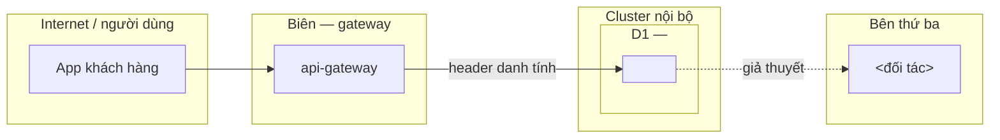

### 2.1 Cụm nghiệp vụ và service

<!-- Một bảng. Mọi repo phải xuất hiện. Dữ liệu nhạy cảm và trọng yếu lấy từ inputs/01_services.md. -->

| Cụm nghiệp vụ | Service (repo) | Vai trò | Dữ liệu nhạy cảm | Trọng yếu |
|---|---|---|---|---|
| **D1 — <tên cụm>** | `<repo-a>` | <1 câu> | <loại dữ liệu> | critical/high/medium/low |
| | `<repo-b>` | | | |

### 2.2 Sơ đồ kiến trúc tổng thể

<!-- Nét liền = có bằng chứng, nét đứt = giả thuyết. Subgraph = vùng tin cậy. ≤ ~30 node. -->

### 2.3 Luồng nghiệp vụ trọng yếu xuyên service

<!-- 3–6 luồng. Mỗi luồng: chuỗi service → kiểm soát kỳ vọng vs quan sát → mắt xích yếu (SID/RC, bước 4.5 đổi sang F-xx). -->

**<Tên luồng, ví dụ: Thanh toán hoá đơn thuê pin>**: `app` → `api-gateway` → `<repo>` → `<đối tác>` → `<repo>` (callback) → SAP.
- Kiểm soát kỳ vọng: <…>. Quan sát được: <…> [có bằng chứng / giả thuyết].
- Mắt xích yếu: <…> (`<SID>`, `RC-x` → F-xx).

### 2.4 Mô hình tin cậy và điểm thực thi kiểm soát

| Ranh giới | Kiểm soát kỳ vọng | Kiểm soát quan sát được | Trạng thái |
|---|---|---|---|
| Internet → gateway | Xác thực token, kiểm scope | <…> | có bằng chứng / giả thuyết |
| gateway → service | Danh tính có toàn vẹn (ký/mTLS) | <…> | |
| service → service | | | |
| service → bên thứ ba | | | |

<!-- ≤5 câu: danh tính truyền thế nào, phân quyền nằm ở đâu, phân đoạn mạng có hay không. -->

### 2.5 Thành phần dùng chung, liên kết ngoài và ảnh hưởng dây chuyền

| Thành phần | Loại | Cụm dùng | Nếu bị chiếm hoặc cấu hình sai thì |
|---|---|---|---|
| `<api-gateway>` | gateway | D1, D2, … | <ảnh hưởng dây chuyền> |

**Liên kết với cụm nghiệp vụ / project khác:** <project, quan hệ, trạng thái: documented/inferred/unknown>.

**Kịch bản dây chuyền tiêu biểu:** "Nếu `<service>` bị chiếm thì … vì … (cạnh/thành phần dùng chung …)".

### 2.6 Đánh giá kiến trúc

**Điểm mạnh có bằng chứng:**
- <…>

**Điểm yếu mang tính hệ thống (không phải lỗi lập trình lẻ):**
- <…> (RC-x / F-xx)

**Giả định kiến trúc chưa được thực thi hoặc chưa kiểm:**
- <…>

**Trade-off cần nêu:**
- <…>
